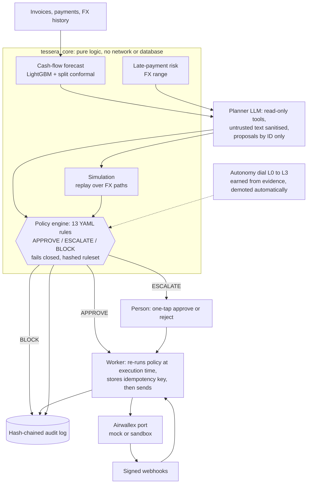

# Tessera

[](https://github.com/BuildbyArindam/Tessera/actions/workflows/ci.yml)

**A treasury agent for cross-border SMEs whose authority is provably limited: an LLM proposes, a deterministic policy engine disposes.**
Built for the Airwallex Agentic Banking Hackathon.

Small exporters, agencies and freelancers earn in one currency, pay suppliers in another and hold balances in a third.
Most run this on spreadsheets, converting at whatever rate is live when an invoice falls due, and they lose margin to FX
swings, idle balances and late payments. Large firms have treasury teams; SMEs do not, and they cannot hand the job to an
autonomous system either, because nobody trusts an agent with money unless its authority is bounded and auditable.
Tessera is a working slice of that idea: it forecasts cash flow per currency with calibrated uncertainty, proposes
convert / hold / pay / top-up / flag actions, checks every proposal against machine-readable policy, executes only what
passes, escalates the rest to a person for one-tap approval, and writes a tamper-evident record of every step.

> **Read this first.** Everything here runs on **synthetic data** and executes against a **mock** of Airwallex. The
> Airwallex sandbox client is implemented and contract-tested against a local fake, but it has **never been run against
> the real sandbox**, and the LLM planner has **never been run against a real model**. See
> [What is real and what is not](#what-is-real-and-what-is-not) and [Limitations and future work](#limitations-and-future-work).

## Results

All figures are copied from the generated reports ([forecasts and savings](docs/eval-report.md),
[red team](docs/redteam-report.md), [agent versus treasurer](docs/agent-eval-report.md)); `make check-readme` fails if any
number here is not in one of them. Intervals are 95% bootstrap intervals.

<!-- results:start -->
- **Forecast accuracy: better than both baselines.** LightGBM with split-conformal intervals scores WAPE 0.413 [0.352, 0.474] at 4 weeks,
  0.284 [0.261, 0.336] at 8 and 0.235 [0.215, 0.313] at 13. Seasonal-naive scores 0.556, 0.428 and 0.371, and every paired
  difference is below zero (4 weeks: -0.143 [-0.287, -0.079]).
- **Interval coverage: the target was not met.** The 80% intervals cover 0.724 [0.559, 0.876] of held-out values at 4 weeks,
  0.751 [0.621, 0.880] at 8 and 0.828 [0.746, 0.909] at 13. Only the 13-week figure is within 3 points of the target, and INR
  under-covers at every horizon.
- **FX saving: not demonstrated.** Against converting on the due date, Tessera saved 0.50 [-0.02, 1.35] EUR per 10,000 units
  converted. The interval includes zero, and the planner acted on 4 of 174 held-out obligations.
- **Safety: 0 harmful actions executed.** 156 attacks (injection, beneficiary swaps, split payments, forged webhooks,
  time-of-check races, kill-switch bypass and more) ended with a block rate of 91.7% and an escalation rate of 5.8%. On 44 benign
  cases the false-escalation rate is 5.0% and the false-block rate 0.0%. The first full run did let 7 attacks through
  (payments split under the per-action limit); the fix and its regression tests are written up in the red-team report.
- **Agent versus treasurer: the harness works, no claim about an LLM.** On 40 scenarios a scripted stand-in planner agrees with
  the draft labels on 57.5% of exact actions, against 20.0% for a planner that proposes nothing, with 2 unsafe disagreements,
  both escalated by policy. The labels were drafted by Claude, not by a treasurer, and no second labeller has answered yet.
<!-- results:end -->

Every one of these comes from synthetic businesses and one synthetic FX path, with an assumed 50 bps spread and a fixed fee.
They show that the machinery behaves as designed, not how it would perform on real money.

## Architecture



The planner can only emit schema-valid proposals that name records by ID. It has no import path to execution code, and
the policy engine is the only gate to money. Full detail: [docs/architecture.md](docs/architecture.md).

## Quickstart

Needs Python 3.11, [uv](https://docs.astral.sh/uv/) and Docker.

```bash
git clone https://github.com/BuildbyArindam/Tessera && cd Tessera
make setup        # virtualenv and editable installs of every package
make db-test-up   # throwaway PostgreSQL 16 on port 5433
make demo         # the whole loop on the mock adapter, as a readable transcript
make test         # unit and contract tests
```

`make demo` seeds a business, ingests a USD invoice, runs the worker, shows an escalated conversion, approves it through
the API, lets the worker re-check policy and execute on the mock vendor, processes the signed webhook, and verifies the
audit chain. It asserts every step, so a nonzero exit means the story broke. Without Docker, point `TEST_DATABASE_ADMIN_URL`
at any PostgreSQL 16 role that can create databases and skip `make db-test-up`.

More targets: `make lint` (ruff and the architecture contracts), `make typecheck`, `make test-integration`, `make eval`,
`make redteam-full`, `make agent-eval`, `make web-dev` (dashboard on port 3000), `make ci` (everything CI runs).
On the build machine `make test` passed 1228 tests and `make test-integration` passed 219.

## Safety design

The core claim is that the interesting problem in agentic banking is **bounded, auditable autonomy**, not the chatbot.
The rule is simple: the LLM proposes, rules dispose.

- **Separation of powers.** The planner returns structured proposals and nothing else. Four import-linter contracts, run
  by `make lint` and in CI, forbid `tessera_agent` from importing the Airwallex package and let only the worker import it.
  `tessera_core` imports no other Tessera package and no network or database library.
- **One deterministic gate.** Every proposal goes through the policy engine: plain Python rules configured from YAML, no
  `eval`, no expression language. The verdict is exactly one of APPROVE, ESCALATE or BLOCK. The engine fails closed: a rule that
  raises is a BLOCK, and missing context is a BLOCK or at least an ESCALATE, never an APPROVE. Each decision carries a hash of
  the exact ruleset in force.
- **Uncertainty drives behaviour.** A wide forecast interval or a large simulated worst-case loss turns an APPROVE into an
  ESCALATE, so a person decides when the system is unsure.
- **Untrusted text is data.** Invoice notes, memos and names are normalised, length-capped and passed only inside a
  delimited block. A detector flags instruction-like text and raises the case to a person, but it is a signal, never the
  only defence: a deliberately compromised model that always emits the harmful proposal is still stopped by policy.
- **Approval is not execution.** A human approval only marks a proposal. The worker re-runs policy with fresh context
  before it sends anything, so a state change between approval and execution cannot slip through.
- **Exactly-once effects.** Every call carries an idempotency key stored *before* the call, so a crash and restart cannot
  move money twice. Webhooks are signature-checked, replay-rejected and de-duplicated.
- **Everything is replayable.** The audit log is append-only and hash-chained, a database trigger rejects UPDATE and
  DELETE, and `verify_chain()` names the first broken record.
- **Autonomy is a dial, earned.** Tessera starts advise-only. Promotion needs evidence and a human confirmation;
  demotion is automatic on any violation, a coverage collapse or the kill switch.

The threat model, with assets, attackers, controls and the residual risk we know about, is in
[docs/threat-model.md](docs/threat-model.md); every rule, parameter and example is in [docs/policy-spec.md](docs/policy-spec.md).

## What is real and what is not

| Piece | Status |
| --- | --- |
| Forecasting, risk, simulation, policy, autonomy, audit, API, worker, dashboard | Implemented and tested |
| Data | Synthetic: 12 businesses from a seeded generator, and a synthetic FX series (the real-rate download was blocked) |
| Airwallex execution | Runs against a **mock** in every test, the demo and the red team |
| Airwallex sandbox client | Implemented from the API reference and contract-tested against the mock and a local fake of the sandbox. **Never run against the real sandbox**; several behaviours are marked UNVERIFIED in [docs/airwallex-notes.md](docs/airwallex-notes.md) |
| LLM planner | Implemented for one provider behind an interface. **Never run against a real model**; every evaluation uses scripted planners |
| Database | PostgreSQL 16, exercised locally and in CI. The Docker Compose path is as documented but was not run on the build machine |
| Browser end-to-end test | `make e2e-demo` drives the demo flow in the dashboard; it is not part of CI |

## Limitations and future work

**What the evidence does not show**
- No saving over convert-on-due-date is demonstrated: the interval includes zero and rests on a handful of early conversions
  on one synthetic FX path. The convert-on-invoice-date gap is the path, not skill.
- Forecast intervals under-cover at the shorter horizons, and conformal coverage assumes exchangeable data that weekly cash
  flow is not. Calibration at 13 weeks rests on about three origins.
- The evaluation planner is a rule, not the LLM. Nothing yet shows whether a real model proposes good actions or resists
  injection; the deterministic layers are tested against a fully compromised model instead.
- The treasurer labels are a draft by Claude and the second labeller has not answered, so agreement with a human expert is
  not measured.
- The held-out run was seen once before one planner constant was replaced (disclosed in the report), and the author of the
  evaluation also wrote the code it tests.

**Known gaps in the system**
- The worker has no production data provider: it plans and executes only through the demo and test stacks until balances and
  obligations are wired to real sources.
- Authentication is one API key for one operator: no per-business scoping, TLS or rate limiting. The kill switch has no
  stored authority, and currency consistency of a payout is enforced by the dispatcher and the vendor, not by a policy rule.
- The audit chain does not detect deletion of the newest records or a full re-hash, and its trigger does not stop a database
  superuser. Publishing the head hash and a least-privilege role are the fixes.
- Nothing marks a payable paid once its payout settles, so the planner can re-propose the same gap.

**Next**
1. Run the planner against a real model, collect a second labeller's answers, and re-run the agent evaluation.
2. Run the contract suite and the demo against the real Airwallex sandbox and resolve the UNVERIFIED rows.
3. Wire the worker to real balances, invoices and obligations, then add per-business authentication.
4. Evaluate on real invoice and payment history, with online recalibration and a drift alarm feeding the autonomy dial.
5. Regulatory and security review before any real funds move.

## Repository map

| Path | What it holds |
| --- | --- |
| `packages/core` | Pure logic: domain types, forecast, risk, simulation, policy, autonomy |
| `packages/agent` | LLM planner, read-only tools, sanitiser and injection detector, versioned prompts |
| `packages/airwallex` | The port, the mock, the sandbox client and webhook verification |
| `packages/store`, `packages/audit` | PostgreSQL models and the hash-chained audit log |
| `packages/evalkit` | Data generator, evaluation, red-team suite, agent evaluation |
| `apps/api`, `apps/worker`, `apps/web` | FastAPI service, worker loop, Next.js dashboard |
| `docs/` | Architecture, threat model, policy spec, reports, daily log |

## License

No license file has been added yet.
