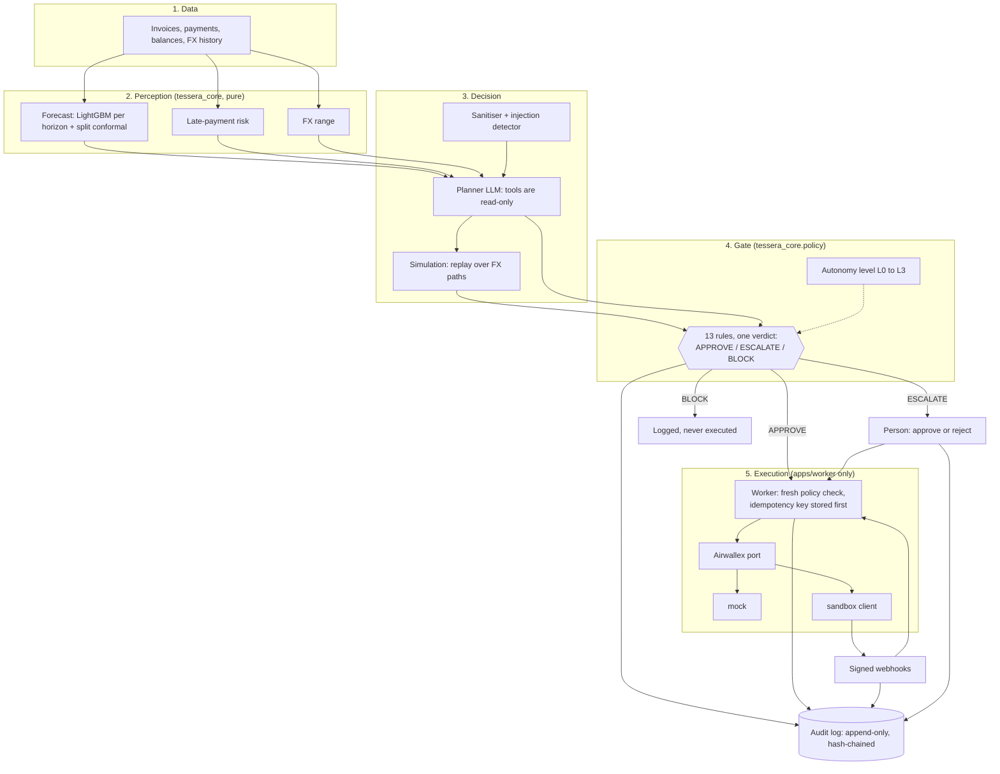
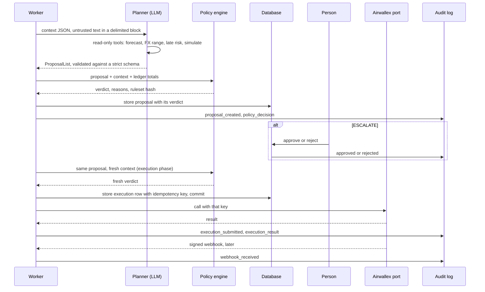

# Architecture

Tessera is five layers and one gate. Data feeds a forecaster and risk models, a planner and a simulator turn their
outputs into proposals, and the **policy engine is the only gate to money**. A worker re-checks policy at execution time,
calls Airwallex through an abstract port, and receives status back through signed webhooks. Every step lands in a
hash-chained audit log.

## Packages and the dependency rule

| Package | Role | May import |
| --- | --- | --- |
| `tessera_core` | Domain types, forecast, risk, simulation, policy, autonomy. Pure: no network, database or LLM. Mypy strict. | nothing else in the repo |
| `tessera_agent` | Planner, read-only tools, strict proposal schema, sanitiser, detector, versioned prompts | `tessera_core` types |
| `tessera_airwallex` | The abstract port, the in-memory mock, the sandbox client, webhook verification | `tessera_core` only |
| `tessera_store` | SQLAlchemy models and repositories | `tessera_core` |
| `tessera_audit` | Append-only hash-chained log, `verify_chain()` | `tessera_store` base |
| `tessera_evalkit` | Data generator, evaluation, red-team suite, agent evaluation | everything except the worker's execution path |
| `tessera_api` | FastAPI service: planning run, approvals, read models | not `tessera_airwallex` |
| `tessera_worker` | The only place that calls the port, plus the webhook endpoint | all of the above |

The safety story depends on this, so it is enforced mechanically, not by convention. `.importlinter` defines four
contracts and `make lint` (and CI) run them first:

1. `tessera_core` imports no other Tessera package and no network or database library (`sqlalchemy`, `httpx`, `fastapi`, ...).
2. `tessera_agent` cannot import `tessera_airwallex`: the LLM side has no path to execution.
3. Only `tessera_worker` may import `tessera_airwallex`.
4. `tessera_airwallex` depends only on `tessera_core`.

Planting a forbidden import breaks the matching contract; this was demonstrated on Day 13.

## A decision's life

1. **Plan.** The worker assembles a context (balances, FX history, approved beneficiaries, obligations) and the planner
   proposes up to five actions at temperature zero. The planner may call only read-only tools. A proposal names
   beneficiaries and invoices by **ID**, never by free text or account number, and extra fields are rejected. An invalid reply
   is retried once and then dropped.
2. **Simulate.** For CONVERT and PAY_SUPPLIER the simulator replays the proposal over block-bootstrapped FX paths using
   only data up to the decision date, and reports expected saving, the 5th-percentile outcome and the cost of spreads and fees.
   The report goes to policy through the context, never through the proposal, so the model cannot state its own risk.
3. **Decide.** The policy engine evaluates the proposal. The decision lists the rules that objected and the hash of the
   ruleset in force. Cumulative limits (daily value, hourly velocity, card totals) are read from a ledger of approved
   proposals, taking the larger of the ledger and any caller-supplied figure, so splitting a payment cannot hide it.
4. **Route.** APPROVE becomes `APPROVED`, ESCALATE becomes `PENDING_APPROVAL` (queued for a person), BLOCK becomes `BLOCKED`.
5. **Approve.** A person's approval only marks the proposal. It never executes anything and never re-runs policy.
6. **Execute.** For every `APPROVED` proposal the worker re-runs policy with fresh context. A BLOCK always stops it, even after
   a human approval. A fresh ESCALATE proceeds only if the ruleset hash is unchanged and every escalating rule also escalated
   when the person looked. Then it stores the execution row and its key, commits, calls the port with that key, and records the outcome.
7. **Reconcile.** Webhooks update the execution. A webhook that arrives before its execution is recorded is stored as
   unmatched and applied on the next cycle.

## Lifecycle

`tessera_core.domain.lifecycle` is a table-driven state machine shared by the API, the worker and the webhook path. An illegal
move raises; nothing repairs it.

| From | May go to |
| --- | --- |
| `PROPOSED` (never stored) | `APPROVED`, `PENDING_APPROVAL`, `BLOCKED` |
| `PENDING_APPROVAL` | `APPROVED`, `REJECTED` |
| `APPROVED` | `SUBMITTED`, `PENDING_APPROVAL` (fresh policy escalates), `BLOCKED` (fresh policy blocks), `FAILED` |
| `SUBMITTED` | `SETTLED`, `FAILED` |
| `REJECTED`, `BLOCKED`, `SETTLED`, `FAILED` | terminal |

An execution has its own states (`PENDING`, `SUBMITTED`, `SETTLED`, `FAILED`), one execution per proposal. A late or
out-of-order webhook that asks for a move backwards is ignored.

## The policy engine

Plain Python rules registered by a string `type` and configured from one YAML file each. Combination is strict: any BLOCK
means BLOCK, otherwise any ESCALATE means ESCALATE, otherwise APPROVE. The engine fails closed: a rule that raises, or a
context that cannot be built, is a BLOCK with reason `policy_error`. It reads no clock, randomness, network or database. Loading
is strict too: unknown parameters, duplicate keys, floats where amounts belong, and a ruleset without a kill switch all
refuse to load. Rules, parameters and worked examples are in [policy-spec.md](policy-spec.md).

**Uncertainty drives behaviour.** Three rules turn doubt into a person's decision rather than a refusal:
`forecast_confidence_gate` (interval too wide, or no confidence data), `worst_case_loss_gate` (simulated 5th-percentile
loss above a ceiling, or no simulation) and `untrusted_input_gate` (the screen flagged third-party text).

## Audit log

`audit_events` is append-only. Each row stores `seq`, timestamp, event type, the canonical JSON payload as text, `prev_hash`
and `hash = sha256(prev_hash + envelope)`, where the envelope also covers `seq`, timestamp and type so an event cannot be
relabelled. A database trigger rejects UPDATE, DELETE and TRUNCATE. `verify_chain()` returns OK or the first broken `seq`.
The `policy_decision` payload holds the context the engine saw, so a decision can be rebuilt and re-run, and the result
(verdict, reasons, ruleset hash) must match. Event types: `forecast_made`, `proposal_created`, `policy_decision`,
`approval_requested`, `approved`, `rejected`, `execution_submitted`, `execution_result`, `webhook_received`,
`autonomy_changed`. Details and limits: [audit-log.md](audit-log.md).

## Autonomy dial

| Level | Runs without a person |
| --- | --- |
| L0 advise-only | nothing; proposals are logged as shadow decisions |
| L1 low-risk | HOLD, FLAG_INVOICE, small conversions |
| L2 standard | adds conversions at higher caps and supplier payouts |
| L3 extended | adds card top-ups, highest caps; every other rule still applies |

The stored level (one database row, default L0) is the only authority and is overlaid onto the policy context at decision
time and again at execution. `AutonomyController` proposes a promotion only when every criterion passes over a rolling evidence
window (no violations, shadow agreement with humans, a positive lower confidence bound on realised saving, forecast coverage
within tolerance); a person confirms it, and confirming re-assesses the evidence. Demotion is automatic on any violation, a
coverage collapse or the kill switch. Every threshold is in `autonomy.yaml`, none in code.

## Persistence and interfaces

PostgreSQL, SQLAlchemy 2 and Alembic (four migrations). Tables: `businesses`, `invoices`, `payments`, `payables`,
`balance_snapshots`, `forecasts`, `late_risk_scores`, `proposals`, `policy_decisions`, `approvals`, `executions`,
`webhook_events`, `audit_events`, `autonomy_state`, `autonomy_promotions`. Money columns are `NUMERIC(20,2)`, never floats.

The API (single API key, middleware before routing) exposes `/businesses`, `/invoices`, `/forecasts`, `/proposals` with
`approve` and `reject`, `/plan/run`, `/policies`, `/autonomy` and `/audit` with `/audit/verify`. The Airwallex webhook endpoint
(`POST /webhooks/airwallex`) runs in the worker process. The dashboard (Next.js) has four screens: Overview, Proposals,
Policies and Audit, and reaches the API through a server-side proxy so the key never reaches the browser.

## Failure and recovery

| If it stops here | What happens on restart |
| --- | --- |
| After the key is stored, before the call | The next cycle replays the pending execution with the same key |
| After the call, before the result is recorded | The adapter finds the vendor's record by its request id instead of creating a second one |
| Fresh policy no longer passes for a pending execution | It is held for a person, never marked failed, because the first call may have gone through |
| A webhook arrives twice | Deduplicated by event id, processed once |
| A webhook arrives before its execution is recorded | Stored as unmatched, applied during reconcile |
| Two planning runs at once | A per-business advisory lock and deterministic proposal ids mean the second writes nothing new |

## Design choices worth defending

- **Separation of powers.** The planner emits schema-valid proposals that reference IDs and has no import path to execution.
- **Uncertainty drives behaviour.** Wide intervals or a large worst-case loss escalate instead of approve.
- **Everything is replayable.** The audit log stores the inputs, the ruleset hash and the verdict, so any decision can be reconstructed.
- **Fail closed, test the failure.** Property tests (Hypothesis) check that malformed input is blocked, that raising an amount never
  loosens a verdict, that rule order is irrelevant, and that no single BLOCK is outvoted.
- **Re-check at the moment of action.** Approval and execution are separated in time, so policy runs at both.

## Not built

The worker's ingest and forecast steps are injected hooks and there is no production world provider, so the worker plans
and executes through the demo and test stacks only. The Airwallex sandbox client has not been run against the real sandbox.
See [Limitations and future work](../README.md#limitations-and-future-work) and [threat-model.md](threat-model.md).
